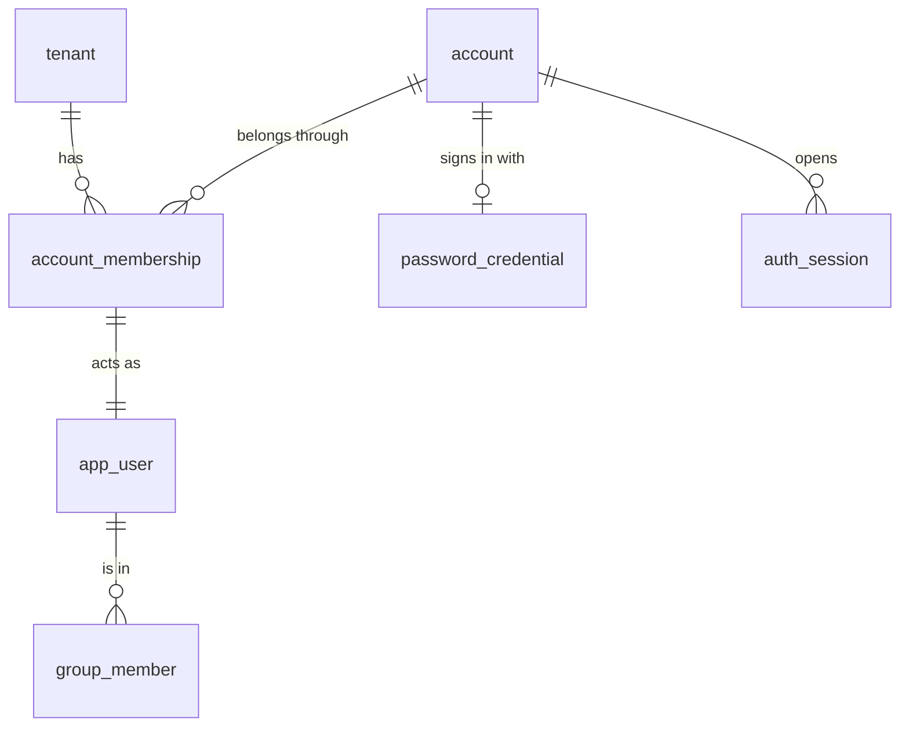
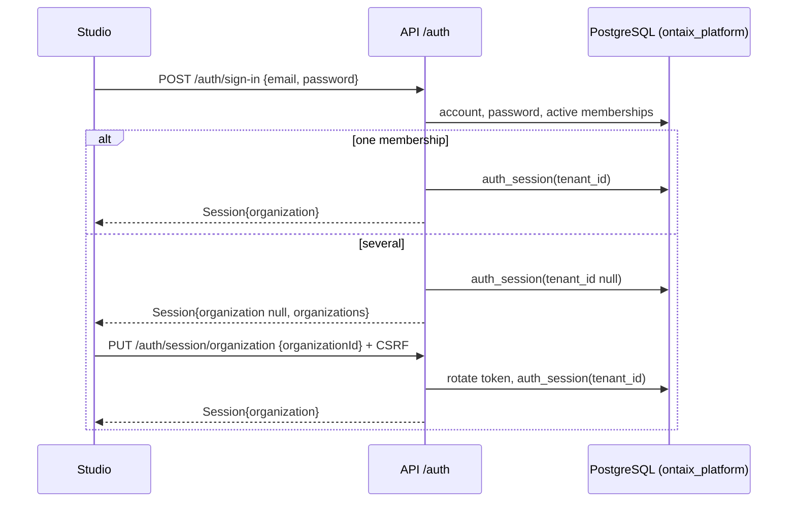

# ADR 0020: Memberships in Several Organizations

Status: Accepted. The requirement is an owner request (Slim, 2026-10-23); the design is approved under owner delegation (decision row 184). It supersedes ADR 0017 section 3 where that section ties a member account to exactly one organization, and resolves the consequence of ADR 0017 that "serving the same person in two organizations needs two emails, or a later decision to add an organization picker".

## Context

The owner asked, verbatim: "I want the possibility to delete a user from a tenant and add him on another tenant", for a consultant who moves from one client to another and for a user created in the wrong organization, and "I want to be able to assign a user to multiple tenant, then he select which tenant he will enter".

Today an `account` is the sign-in identity, its email is unique across the deployment, and a member account carries one `tenant_id` and one `user_id` (its `app_user` row, issuer `local`, subject the account id). `app_user` is the per-organization directory under row-level security; proposals, approvals, groups and audit rows name it. The super admin creates accounts per organization and can disable, enable and reset passwords; nothing removes a user from an organization or adds an existing account to another. The sign-in page has no organization field.

## Decision

### 1. Account and Membership

An account is a person: one email, one password, across the deployment. A membership links an account to an organization through that organization's directory user. A new table `account_membership (account_id, tenant_id, user_id, disabled_at, removed_at, created_at)` holds one row per account and organization (`UNIQUE (account_id, tenant_id)`, `UNIQUE (user_id)`, composite foreign key `(tenant_id, user_id) -> app_user`). It carries `tenant_id`, so it has row-level security like every such table, and only the platform role reads it, like the other sign-in tables.

`account.tenant_id` and `account.user_id` go. `account.is_platform` becomes a stored boolean (it is generated from `tenant_id` today); a platform account holds no membership. A membership's directory user has issuer `local` and subject `<account id>:<tenant id>`, the scheme the super admin's acting user already uses, so `UNIQUE (issuer, subject)` holds when one account belongs to several organizations. The migration creates one membership per member account from its `tenant_id` and `user_id`, moves the member account's `disabled_at` to that membership, and rewrites the `local` subjects.

### 2. Directory Actions

The platform portal stays the only place that manages the directory (decision row 177). On an organization's Users page the super admin can:

- **Add user** (unchanged): a new account with its first membership. An email that already has an account is refused with `409 email_taken`, and the message points to Add existing account.
- **Add existing account**: `POST /admin/organizations/{organizationId}/memberships` with `{email, groupIds}` adds a membership for an existing member account. A platform account, an unknown email and an account already a member are refused (`404 account_not_found`, `409 already_member`). An account removed from this organization earlier gets its membership and directory user back, with the groups chosen now, so its history stays one user.
- **Remove from organization**: `DELETE /admin/organizations/{organizationId}/users/{userId}` sets `removed_at`, drops the user's group memberships and ends every session of the account that is inside this organization. The directory user stays, because proposals, approvals and audit rows name it; a removed user is not listed. The account and its other memberships stay. An account left with no membership remains and can be added again.
- **Disable / Enable** act on the membership only; the person keeps access to their other organizations.
- **Reset password** resets the account's one password; the dialog says it applies to every organization of the account.

Moving someone is Remove in one organization and Add existing account in the other.

### 3. Choosing the Organization

Sign-in stays email and password. After a successful sign-in (and a forced password change, when one is due):

- an account with one active membership enters it directly, as today;
- an account with several sees **Choose an organization**, a list of its organizations by name; picking one calls `PUT /auth/session/organization` with `{organizationId}`, which rotates the token and records the organization in `auth_session.tenant_id`;
- an account with none is refused after the password check with `403 no_organization`: "Your account belongs to no organization. Ask your administrator."

The `Session` gains `organizations: OrganizationRef[]`, the account's active memberships in enabled organizations. `organization` is null until one is chosen, and member endpoints answer `403 organization_not_chosen` until then. The account menu shows **Switch organization** when `organizations` holds more than one; it returns to the choice screen. `resolve_session()` returns the tenant and user of the session's membership only while the membership is active and the organization enabled, so a removal or disable takes effect at the next request.

### 4. Accountability

New platform audit actions `membership_added`, `membership_removed` and `organization_chosen`, each mirrored into the organization's audit log as `account_created` is. Disable, enable and reset keep their actions and now name the membership's organization.

## Consequences

- The tenant isolation of ADR 0017 section 7 is unchanged: every request still binds one tenant, and a person in two organizations is two directory users that never see each other's rows.
- The OpenAPI spec, the database schema and the audit action list change; the Studio gains one screen and one menu item. Every existing screenshot scene, including sign-in for an account with one organization, stays as it is; the new screen and dialogs get new baselines.
- Directory names (name, department) are per organization, because they live on the directory user; the email and password are per account.
- No organization is remembered between sign-ins for an account with several; the choice is asked each time.
