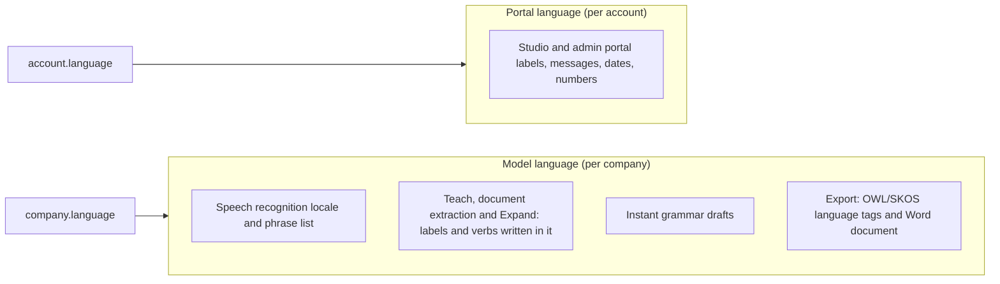

# ADR 0021: Languages - Portal Language and Model Language

Status: Accepted. The requirement is an owner request (Slim, 2026-10-29); the design is approved under owner delegation (decision row 186).

## Context

The owner asked, verbatim: "I want this app to be functional in french and german with the possibiliy to change the portal language and the speaking/teaching/documentation language (everything that goes through the model), I want it to be extremely accurate when capturing", then "do everything yourself".

Today everything is English. The Studio's labels are English literals in the components. Speech recognition is English only (`ONTAIX_SPEECH_LANGUAGE`, `en-GB` or `en-US`; the browser fallback picks `fr-FR` or `en-GB` from `navigator.language`). The teach, document extraction and Expand prompts ask for labels "in the company's language" without telling the model which language that is. The grammar that shows instant drafts while the model answers reads English only. The export writes `EXPORT_LANGUAGE = "en"`.

## Decision

Two independent languages, each one of `en`, `fr`, `de`. English stays the default everywhere, so an organization that changes nothing sees nothing change and no screenshot baseline moves.

### 1. Portal Language

- Belongs to the person: a nullable `account.language` (`en`, `fr`, `de`). Unset, the Studio uses the browser's language when it is one of the three, else English.
- The person changes it in the account menu (a "Language" choice with the three languages, each written in its own language: English, Français, Deutsch). The change is immediate, saved through the session API and kept in the browser too, so the sign-in page opens in the last language used on that browser.
- It covers every label, message, tooltip, ARIA label, placeholder, toast, dialog and admin page, plus date and number formats. It never changes ontology content (concept labels, verbs, company names), which stay as the people and the model wrote them.
- The Studio keeps one source dictionary in English and one dictionary per other language, typed against the English keys so a missing translation fails the type check. No new runtime dependency.
- Element ids, keyboard shortcuts and ARIA roles do not change with the language; `docs/ui-contract.md` labels are the English source strings.

### 2. Model Language

- Belongs to the company: `company.language` (`en`, `fr`, `de`), default `en`, chosen when a company is created and changed by an Administrator in the admin portal. The change is immediate and audited; it is a company setting, not an ontology change, so it is not a proposal. It does not translate concepts already in the model.
- Everything that goes through the model for that company uses it:
  - **Speech:** the speech token carries the company's language and the recogniser runs in `en-GB`, `fr-FR` or `de-DE`, with the company's labels as its phrase list. The browser fallback uses the same locale. `ONTAIX_SPEECH_LANGUAGE` stays as the English locale choice (`en-GB` or `en-US`).
  - **Teach (typed and spoken), document extraction and Expand:** the prompt names the language; the model writes new labels, specs and relation verbs in it, accepts input in any of the three languages, and keeps existing labels unchanged. Matching of existing concepts (singular and plural, sound-alike, aliases) handles French and German forms, accents and the German sharp s and umlauts.
  - **Instant grammar drafts:** French and German grammars give the same instant drafts as English for simple sentences; when the grammar cannot read a sentence it gives none and the model answers alone.
  - **Export:** OWL and SKOS labels carry the company's language tag; the Word document's headings and fixed text are written in that language.
- The teach bar shows the active company's model language next to the microphone, so the speaker knows which language is being listened to.

### 3. Capture Accuracy

- Recognition runs in one known language per company (no automatic language detection, which is less accurate on short sentences).
- Azure Speech gets the phrase list in the company's language and dictation mode, so punctuation splits sentences the way the speaker says them.
- Each language gets its own few-shot examples in the teach prompt, and the eval sets gain French and German cases. Paid eval runs stay within the owner's budget rule and are not run without the owner.

## Consequences

- One migration adds `account.language` (nullable) and `company.language` (not null, default `en`). The OpenAPI contract, the schema and the event catalogue change; `docs/contracts.md` and `docs/ui-contract.md` say so.
- English remains the source of every Studio label; every new label needs its French and German entries in the same change.
- Changing a company's language after it has concepts gives a mixed-language model until people rename the old concepts; translating a model is a later decision.
- Locally, voice works through Azure Speech only when the local `.env` names the Speech resource and the developer's `az login` identity holds a Speech role on it; otherwise Chrome's own recogniser is used.
